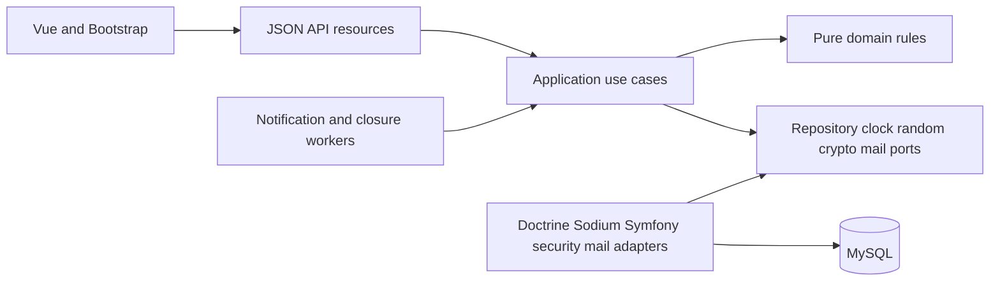

# Plan 001 — Toca Regalo

Status: approved v0.3; task execution and installation remain separately gated
Approval (v0.3): “apruebo la revisiones y autorizo actualizar las listas de tareas”, 2026-11-17. Approves displayed plan revisions and authorizes task-list preparation only.
Revision: v0.3
Historical approval (v0.1): The user explicitly stated “Apruebo el plan” on 2026-11-16 in response to the request to approve v0.1 and proceed to task decomposition. Unchanged architecture and prior evidence retain that approval.
Approval (v0.2): “Apruebo estas revisiones y autorizo actualizar las tareas”, 2026-11-17, approves the displayed PHPStan plan revision and authorizes task-list preparation, not implementation or installation.
Approved specification: [v1.1](./spec.md)
Constitution: [v1](../../docs/constitution.md)
Scope: v0.1 remains the approved application architecture; proposed v0.2 adds the NFR-10 tooling/completion gate. Task-list preparation is authorized; installation and task execution still require explicit approval.

## 1. Approach and observed environment

Build one repository with a Vue frontend and a Symfony/API Platform backend behind Nginx, using MySQL for application data, sessions, and durable notification work. Keep pure domain rules independent of Symfony/Doctrine through external ORM mappings and application ports. Add workers only for specified asynchronous notification and event-closure behavior.

The user explicitly approved specification v1.0 and subsequently this plan v0.1. Its technical choices are the approved basis for task decomposition; product requirements remain unchanged.

Read-only environment inspection found Docker Engine client/server 29.9.3 and Compose v5.7.1. Access to the Docker socket required host approval for the version query. PHP, Composer, Node, and npm were not found on the host PATH; Perl is available. Use containers for project tools rather than install host runtimes. No images were pulled, containers created, or packages installed. The existing repository contains governance/source documents, a license, and an older Symfony-oriented ignore file, but no application manifests, CI, or tests.

## 2. Proposed toolchain and dependency boundary

| Component | Proposed family | Reason |
| --- | --- | --- |
| PHP | 8.5, patched release pinned at bootstrap | Supported runtime; Symfony password hashing and Sodium encryption available; reference-command syntax supported. |
| Symfony | 7.4 LTS | Long support window; sufficient features without choosing a prerelease or short-support branch. |
| API Platform | 4.2 stable line | Symfony 7.4-compatible API resources/providers/processors; install components without the full distribution or Twig UI. |
| Doctrine | ORM 3, DBAL 4, compatible bundles/migrations | Relational mapping and migrations; defaults derived from selected mappings rather than invented lengths. |
| Database | MySQL 8.4 LTS | Mandated engine with a stable support branch, InnoDB transactions and row locks. |
| Frontend | Vue 3, Vue Router 4, Bootstrap 5.3, JavaScript modules | Required stack; routing needed for defined screens; no additional state library required. |
| Frontend build | Node 24 LTS, npm, Vite 8 and Vue plugin | Compatible build baseline; host runtimes unnecessary. |
| Phone input | Vue Tel Input, compatible Vue 3 stable release | Existing plugin supports disabling auto-format and custom input validation. Wrap for the exact `+`/digits behavior; disable IP-based country lookup. |
| SMTP capture | Mailpit 1 stable line | Local SMTP plus inspectable messages; development-only service, not a delivery provider. |
| Reverse proxy | Nginx stable release | Required frontend/API entry point, no PHP-rendered HTML. |
| PHP verification | PHPUnit 12; Symfony BrowserKit/Clock test helpers | Isolated domain tests and real-MySQL/API checks with controlled time. |
| PHP static analysis | PHPStan 2, fixed level 10; compatible Symfony/Doctrine/PHPUnit extensions in major 2 | NFR-10 requires zero post-task errors on project-owned PHP, including tests, without baseline concealment. Separate installation approval required. |
| UI verification | Vitest compatible stable version, Vue Test Utils 2, Playwright 1 | Component timer/forms and full browser flows; match Playwright image to installed version. |

The proposed families require approval of this plan. Exact patch versions, image digests, npm/Composer lockfiles, and dependency compatibility must be recorded during the authorized bootstrap task. Do not use floating `latest` images or silently switch major families on resolution failure. Check compatibility without running dependency installation before the user authorizes it.

Backend package groups: Symfony Framework/Security/PasswordHasher/Validator/Serializer/Console/Clock/Mailer/Messenger/Doctrine transport/CSRF support; API Platform Symfony and ORM integration; Doctrine ORM/bundle/migrations. Prefer their standard components rather than an all-inclusive web pack. No Twig, Twig bundle, WebProfiler, Swagger HTML UI, GraphQL, CORS bundle, Redis, RabbitMQ, JWT library, or frontend state framework is needed. Composer plugins and recipes must be reviewed; only necessary plugins are allowed explicitly. API responses and optional OpenAPI export are JSON, never backend views.

Rejected alternatives: Symfony 8.2 prerelease would add release risk; a full API Platform distribution would introduce unwanted services/framework conventions; TypeScript adds a new toolchain decision without a requirement; Pinia/Axios are unnecessary for these flows because small composables and native fetch suffice. None are prohibited forever, but changes need a recorded approved reason.

### Primary-source compatibility references

Consulted for this plan on 2026-11-16; version-resolution and runtime validation are still pending:

- [Symfony releases](https://symfony.com/releases) identifies 7.4 as LTS; [7.4 setup](https://symfony.com/doc/7.4/setup.html) states its PHP baseline.
- [PHP support table](https://www.php.net/supported-versions.php) supports the proposed runtime branch.
- [API Platform 4.2 Composer manifest](https://raw.githubusercontent.com/api-platform/core/4.2/composer.json) permits PHP/Symfony/Doctrine combinations used here and lists Twig for optional Swagger integration rather than core API use.
- [MySQL release model](https://dev.mysql.com/doc/refman/8.4/en/mysql-releases.html) describes the LTS branch choice.
- [Vue quick start](https://vuejs.org/guide/quick-start), [Vite requirements](https://vite.dev/guide/), and [Node release schedule](https://github.com/nodejs/Release) support the frontend build proposal.
- [Bootstrap 5.3](https://getbootstrap.com/docs/5.3/getting-started/introduction/), [Vue Tel Input props](https://iamstevendao.com/vue-tel-input/usage/props.html), and [Mailpit configuration](https://mailpit.axllent.org/docs/configuration/) describe the selected UI/capture integrations.
- [Doctrine mapping](https://www.doctrine-project.org/projects/doctrine-orm/en/current/reference/basic-mapping.html), [DBAL types](https://www.doctrine-project.org/projects/doctrine-dbal/en/current/reference/types.html), and [MySQL platform implementation](https://raw.githubusercontent.com/doctrine/dbal/4.3.4/src/Platforms/AbstractMySQLPlatform.php) support the mapping/default-length discussion below.
- [Sodium authenticated encryption](https://www.php.net/manual/en/function.sodium-crypto-aead-xchacha20poly1305-ietf-encrypt.php), [Symfony Messenger retry settings](https://symfony.com/doc/7.4/messenger.html), [PHPUnit requirements](https://docs.phpunit.de/en/12.5/installation.html), [Vitest](https://vitest.dev/guide/), and [Playwright](https://playwright.dev/docs/intro) support the encryption, delivery, and verification approaches.

## 3. Files and responsibilities

Paths below are planned, not existing implementation. Keep documents in English except user-facing setup/help and application strings, which are Spanish.

| Paths to create or change | Responsibility |
| --- | --- |
| `compose.yaml`, `compose.test.yaml`, `.env.example`, `.dockerignore` | Services, isolated test database, ports/timezone, placeholders, build context exclusions. |
| `docker/php/Dockerfile`, `docker/nginx/default.conf`, `docker/node/Dockerfile` | Reproducible PHP extensions/tools, API/SPA routing, frontend build image. |
| `docker/worker/`, `docker/scheduler/`, `scripts/dev`, `scripts/check` | Worker/closure entrypoints and documented development/check wrappers; scripts never install implicitly. |
| `.vscode/tasks.json`, `.editorconfig`, `.gitignore` | Tasks for approved build/run/check commands, UTF-8 conventions, nested dependency/build/cache/secret exclusions. Preserve current unrelated rules. |
| `backend/composer.json`, `backend/composer.lock`, `backend/config/`, `backend/public/index.php`, `backend/bin/console` | Minimal Symfony API application and dependency/configuration lock. |
| `backend/src/Domain/User/`, `Group/`, `Event/`, `Draw/` | Plain PHP entities/value objects and pure rules without framework/persistence imports. |
| `backend/src/Application/` | Use cases, transaction orchestration, authorization policies, DTOs, and ports. |
| `backend/src/Infrastructure/Doctrine/`, `Security/`, `Crypto/`, `Mail/`, `Clock/` | ORM repositories, session/hasher adapters, authenticated encryption, notification transport, system clock. |
| `backend/config/doctrine/*.orm.xml`, `backend/migrations/` | External mappings and schema migrations; domain objects contain no ORM attributes or collection dependencies. |
| `backend/src/Api/Resource/`, `State/`, `Controller/`, `backend/src/Command/` | Explicit JSON contracts, scoped providers/processors, security adapters, bootstrap and closure commands. Never expose entities by generic serialization. |
| `backend/tests/Unit/`, `Integration/`, `Functional/`, `backend/phpunit.xml.dist` | Domain proofs/invariants, real-MySQL boundaries, API behavior and privacy/concurrency regressions. |
| `frontend/package.json`, `package-lock.json`, `vite.config.js`, `index.html`, `src/main.js` | Locked Vue build, static SPA entrypoint, Bootstrap setup. |
| `frontend/src/api/`, `router/`, `composables/` | Same-origin API client, route guards, session/forms/reveal state. |
| `frontend/src/views/`, `components/`, `plugins/phone.js`, `assets/` | Defined screens, sidebar/cards/forms/confirmations, restricted phone component, responsive styling. |
| `frontend/tests/`, `frontend/vitest.config.js`, `tests/e2e/`, `playwright.config.js` | Timer/input/UI-state checks and browser workflows with fixtures. |
| `README.md`, `docs/development.md`, `docs/architecture.md`, `docs/security-operations.md` | Spanish user-facing setup instructions; English technical architecture, runtime operations, key/backup/recovery instructions. |
| `specs/001-toca-regalo/verification.md`, `AGENTS.md`, `MEMORY.md` | Requirement evidence, approved technical constraints, task/phase history; created/updated only at their authorized phases. |

Do not create a CI provider configuration until a provider is selected; local reproducible check wrappers are sufficient for this approved scope and can later be invoked by CI without changing checks.

## 4. Components and dependency direction



Domain has no knowledge of HTTP, database sessions, Doctrine, Symfony, email delivery, or Vue. Application accepts authenticated actor context, validates permissions, loads domain values through ports, and persists decisions atomically. Infrastructure implements the ports. API providers return operation-specific projections; command processors call application use cases rather than modify entities directly. Avoid interfaces for trivial local helpers; ports exist only at required external boundaries.

Core ports: `UserRepository`, `GroupRepository`, `EventRepository`, `DrawRepository`, `NotificationRepository`, `TransactionRunner`, `Clock`, `RandomIntSource`, `RecipientCipher`, `PasswordService`, and `MailTransport`. Pure policies consume IDs, membership sets, times, and states, without calling those services themselves.

## 5. Data model and migrations

| Table/model | Data and constraints |
| --- | --- |
| `users` | Integer surrogate ID; email and case-folded unique email comparison column; unique cleaned phone; password hash; first name and nullable surnames. No verification flag. |
| `roles`, `user_roles` | Unique role names `ROLE_USER` and `ROLE_SUPER_ADMIN`, unique user/role membership; normal creation assigns USER. Bootstrap creates SUPER ADMIN role if absent. No role-management API. |
| `gift_groups` | Name, nullable description, one non-null creator-owner FK. One owner column enforces current single ownership. |
| `group_memberships` | Unique group/user pair; creator membership inserted atomically with group. Membership does not imply ownership. |
| `events` | Name, nullable event date, nullable notes, group FK, one nullable completion timestamp. No second scheduled/actual completion field or reopening operation. |
| `draws` | Unique event FK, revision token, valid/invalid state. Replacement changes revision, assignments, and pending delivery references atomically. No user-visible draw-history feature. |
| `assignments` | Draw FK, nullable giver FK, nullable encrypted recipient envelope and scoped blind lookup token. Unique non-null giver per draw and unique recipient lookup token per draw. No plaintext recipient FK/name column. |
| `notifications` | Recipient user FK where applicable, draw/assignment ID plus revision, message purpose, state, attempts, next due time, sanitized failure code, stable delivery identifier. Payloads never persist recipient names or decrypted recipient IDs. |
| `password_reset_requests` | User FK, hashed random token, expiry, consumed/superseded state. Raw tokens are delivered only through reset email and never logged. |
| `sessions`, transport storage | Symfony-compatible database session storage and durable delivery work. Keep distinct test/development databases. |

Proposed mappings: `string` attributes use Doctrine's default length of 255 unless a framework-owned field requires another documented mapping; `text` attributes use the selected DBAL MySQL mapping without an invented application length, typically LONGTEXT when unspecified. Name, surnames, email and phone use strings; group description and event notes use text. Event date uses nullable `date_immutable`; completion uses nullable `datetime_immutable`, precision seconds. Store instants in UTC and convert the selected day using the configured installation timezone; this is a storage representation, not a change from system-time business rules. Set PHP, workers, and database session timezone handling consistently, including DST tests.

Email comparison lowercases after surrounding trim and uses a binary unique index on that normalized value so accents are not unintentionally collapsed for email uniqueness. Phone unique comparison uses the cleaned `+`/digits value. Name/email search uses explicit case/accent-insensitive MySQL collation with escaped LIKE wildcards and bound parameters; search semantics do not change email uniqueness. Validate missing/blank required names after trim and surface database-unique races as field errors. Verify actual generated DDL/default lengths against installed Doctrine/MySQL in the mapping task and document them before declaring it complete.

Group/event/draw deletion uses database cascades where references are not encrypted. Giver references use actual `ON DELETE SET NULL`. Recipient references use application-managed null semantics described below. Removing an account does not cascade into other users. Group deletion requires explicit confirmation and removes pending work for removed events; no metadata edit triggers a draw.

### Recipient encryption and deletion/null semantics

Propose Sodium XChaCha20-Poly1305 authenticated encryption with a fresh random nonce for every envelope. Encrypt only the recipient ID; store key version, nonce, ciphertext and authentication tag. Bind ciphertext to stable assignment ID, draw ID, and revision as authenticated associated data; do not bind it to a giver FK that will become null on deletion.

Use a distinct derived HMAC key to compute `HMAC(key, drawId || recipientUserId)` as a scoped lookup token. This allows uniqueness and account-deletion lookup without a readable recipient foreign key. A database reader cannot map the token to a user without the key; tokens do not identify the same recipient across draws. This is an application foreign-reference contract, not a fictitious encrypted MySQL FK.

For account deletion, visit surviving draws under the transaction lock order, compute lookup tokens using each envelope's retained key version, and null matching recipient ciphertext/nonce/token/key fields. Null giver FKs as well. Then delete the user's owned groups and account, remove other memberships, and replace or invalidate affected unfinished-event draws. Finished-event draw references become null without redraw. All recipient-reference cleanup and cascade/redraw decisions commit together. A missing required key prevents the destructive transaction from partially applying; report a technical failure without claiming successful deletion.

### Proposed key policy for approval

- Generate a cryptographically random 32-byte master secret through an explicit operational command after authorization. Do not generate keys during plan preparation or commit them. Derive independent encryption and scoped-index subkeys using labeled key derivation; preserve a versioned key ring.
- Mount key material as a read-only runtime secret file for API/worker/operational commands, outside the image, repository, database, logs, and frontend. Development uses a separate ignored local secret file; deployment uses the operator's secret storage/mount mechanism rather than adding a cloud vendor dependency.
- Keep an encrypted offline backup of the key ring separately from encrypted database backups, with operator-controlled access. Test restoration with a database copy before relying on backups. Without the matching keys, encrypted assignments cannot be recovered; do not create an insecure plaintext fallback.
- Rotation is an explicit maintenance operation: introduce a new version for writes, re-encrypt/reindex retained assignments transactionally, validate decryption/null-lookup behavior, and keep old versions until no retained assignments or required restorable backup depends on them. Do not select a calendar retention period absent a business requirement.
- Restrict decrypted values to own-assignment responses and the addressed user's email render path. Notification status/resend responses contain no other user's assignment. SMTP capture contains the expected email bodies and is a development-only operator surface; do not expose it as an application page.

Rejected alternative: a plaintext recipient FK plus encrypted duplicate would leak the assignment directly through the FK. Database-at-rest encryption alone also fails the requirement against readable database rows. A scoped keyed index adds key-management work but preserves the required lookup/null behavior without plaintext recipient identity.

## 6. Pure rules and algorithms

| Pure operation | Inputs → outputs |
| --- | --- |
| `normalizePhone` | Raw string → cleaned `+`/digits string or field error. Remove specified whitespace/signs, preserve only leading prefix `+`, reject missing prefix and malformed remaining content. |
| `normalizeUserText` | Names/email → surrounding-trimmed values and case-folded email comparison key; no password trim. |
| `isEventClosed` | Completion instant/null, current instant → boolean. Boundary comparison is independent of scheduler execution. |
| `validateAssignment` | Member IDs, giver/recipient map → violations or valid; all included once in both roles, no self-reference, minimum three. |
| `drawAssignments` | Distinct member IDs, injected random integer source → uniform valid giver/recipient map or insufficient-members result. |
| `membershipDrawDecision` | Event closure, current draw state, before/after members → no change, replace, or invalidate. No initial draw is created merely by adding members if no draw previously existed. |
| `retryDelay` | Positive base, retry index 1…5 → base × 2^(index−1). State machine ends after success, cancellation, or retry exhaustion. |

Uniform draw pseudocode:

```text
require at least 3 distinct members
repeat:
    recipients := copy of members
    Fisher–Yates shuffle recipients using uniform random integers
until no recipients[i] equals members[i]
return members[i] -> recipients[i]
```

Every permutation is initially equally probable; rejection filters only self-assigned permutations, so conditioning yields equal probability for every valid complete assignment. Acceptance probability tends to 1/e; expected attempts are approximately e, not factorial enumeration. Do not use a bounded retry fallback that silently biases results or Sattolo's single-cycle algorithm, which excludes valid multiple-cycle assignments. Inject `random_int` via an adapter and deterministic streams in tests. Random-source failure becomes an operation failure, not a partial draw.

At n=3 verify both valid assignments; at n=4 verify all nine, including two disjoint two-member cycles. Enumerate all shuffle-choice sequences for small n and count resulting permutations/accepted outputs exactly; assert invariants for larger memberships. This validates the algorithm without a flaky statistical pass threshold.

## 7. Transactions, clocks, and concurrent operations

Use one application transaction boundary per mutation. Lock affected group rows in ascending ID order, then event/draw rows in ascending ID order; user-deletion orchestration must use the same shared lock-order service and coordinate user/account locks before member insert/delete so it cannot miss a concurrently added membership. Re-read membership and closure inside locks, not from client-supplied state. Serialize owner/account/group deletion and membership mutation through these services; no direct ORM writes from API processors.

For a manual draw: lock group/event, recheck authorization and logical closure using the clock, check whether a draw already exists, then generate/validate/encrypt assignments and insert revision plus notification work in one transaction. An already valid draw returns the required Spanish notice without mutation. Do not enqueue work before commit. A second concurrent request sees the committed draw and produces no duplicate initial notification set. For membership changes, update group membership once, ignore duplicate association, and reevaluate each affected unfinished event; finished events retain their draw except required null-reference cleanup on account deletion.

Represent user-selected completion dates as the final second of that local day using the installation timezone; form explains the rule. Manual closure writes the actual current instant. `isEventClosed` checks the same field on every draw/reveal/resend/worker boundary, not a separate background-maintained boolean. Process due events every 15 seconds with an injected clock and cancel queued assignment deliveries; the configured runtime must meet the 60-second processing budget. Changing metadata cannot reopen an event; modifying a closed completion value is not offered as a reopening path.

For pending notifications, persist work and the Messenger Doctrine transport message in the same MySQL transaction/connection as the draw, keyed by message ID/revision/user. Workers consume IDs only. Messenger owns retry scheduling/counts: max retries five, multiplier two, base 30000 ms configurable, zero jitter and no truncating cap. Handler/failure events mirror attempt count, next due, and final state into the notification record from the current retry stamp; they never start an independent retry loop. Final failure updates status without leaking the exception payload. Recovery messages use the same transport adapter but their expiry/supersession guard applies before delivery; do not let a failed assignment retry regenerate a draw.

Immediately before SMTP handoff, reload authoritative event/revision/account state; cancel stale work and do not render recipient names from queued snapshots. Sending uses a synchronous Mailer transport inside the application delivery worker so there is no second hidden mail queue containing stale plaintext. Serialize competing deliveries through message leases/unique identifiers and state checks. A new manual resend creates a new authorized delivery sequence for the current valid assignment without redrawing. Failure visibility exposes destination member identity and sanitized status only, never the assignment.

SMTP acceptance is an external boundary: already handed-off messages cannot be recalled, and a process crash after SMTP acceptance but before recording success may cause an email retry. Use stable Message-ID and durable state to reduce duplicates; do not claim exactly-once external email delivery. Stale-work cancellation is guaranteed before handoff after observing closure/replacement; test races using barriers and controlled clocks. If literal cancellation of mail already accepted by an external server is required later, that is a specification feasibility issue, not something to claim implemented.

## 8. API and authorization contracts

Serve only explicit JSON resource DTOs under `/api`. Disable generic entity exposure, assignment collections, Swagger/ReDoc HTML UI, debug profiler, and template rendering. Reject role/owner/recipient fields submitted through ordinary forms. Use Symfony session authentication with one same-origin Nginx entry point, HttpOnly session cookie, secure cookies under HTTPS, CSRF on mutations, and JSON login/logout/reset endpoints. Local HTTP development can use its explicit nonsecure-cookie configuration; production requires TLS supplied by deployment.

| Endpoints | Contract and checks |
| --- | --- |
| `POST /api/login`, `POST /api/logout`, `GET /api/me`, CSRF initialization endpoint | Login accepts `identifier` (email or cleaned phone) and password; session actor projection has own attributes/roles only; no public registration. Logout invalidates session. |
| `POST /api/password-recovery`, `POST /api/password-reset` | Issue emailed hashed-token-backed reset; configurable one-hour expiry, single-use, supersede earlier tokens; never return reset token from API. |
| `PATCH /api/me`, `DELETE /api/me` | Update only own allowed attributes/password; confirmed account deletion and described cascades/null/redraw. Role/ownership modification unavailable. |
| `GET/POST /api/groups`, `GET/PATCH/DELETE /api/groups/{id}` | USER ownership filter; SUPER ADMIN management override; creation inserts owner membership; confirmed delete. |
| `GET/POST /api/groups/{id}/members`, `DELETE /api/groups/{id}/members/{userId}` | Owner/SUPER ADMIN group management; create user or associate existing ID through separate explicit input; duplicate notice; confirmed removal without account deletion. |
| `GET /api/users/search`, scoped `GET /api/users`, admin user operations | Owner search with four partial AND filters and name-only result DTO; owners cannot patch other users; SUPER ADMIN can manage account data/delete per FR-22/23. |
| `GET/POST /api/groups/{id}/events`, `GET /api/events`, `GET/PATCH/DELETE /api/events/{id}` | Scope to owned group or SUPER ADMIN; metadata edit never triggers draw; completion scheduling validated separately. |
| `POST /api/events/{id}/finish`, `POST /api/events/{id}/draw`, `DELETE /api/events/{id}/draw` | Owner/management authorization, closure checks, concurrency notice; draw deletion SUPER ADMIN only, including finished draws. |
| `GET /api/dashboard`, `GET /api/events/{id}/my-assignment` | Own cards, own recipient only, no owner/admin bypass. Invalid/closed states do not reveal old recipients. Response is no-store; client clears revealed data on concealment/navigation/logout. |
| `POST /api/events/{id}/notifications/{userId}/resend`, delivery-status projection | Self, owner for group member, or SUPER ADMIN; valid current unfinished draw required. Status and action never return another member's recipient. |

Use conventional JSON status codes (401 unauthenticated, 403 unauthorized, 404 unavailable resource, 422 field validation, 409 state conflict) with Spanish user messages and stable error keys. Duplicate membership/already-performed draw are nonmutating notices, not new draws. HTTP status/DTO details are proposed interface choices, not extra product operations. A recipient ID is never available through general user/event serialization, role-management endpoints, errors, or logs.

## 9. UI states and interactions

| Screen | Planned interaction/state coverage |
| --- | --- |
| Login/recovery/reset | Email-or-phone identifier, password, Spanish field errors, submit loading, reset expired/used/superseded errors, no registration/verification link. |
| Dashboard | Own unfinished-event cards, initially concealed recipient, reveal timer restarted on every activation, own resend, invalid “Participantes insuficientes” without reveal, owned-group card, visible empty/loading/error states. |
| Users | Owner-scoped list, create with initial password, four-field partial AND search showing name/optional surnames, associate/remove with duplicate notice and confirmation; no edit of another member for USER. |
| Groups | CRUD, duplicate group names allowed, create/search-and-associate flows, confirmed cascade deletion, membership removal preview with special below-three warning. |
| Events | Owner-scoped CRUD, optional schedule with end-of-day/system-time explanation, past-date validation, valid/invalid/no-draw/finished states, draw/finish actions, SUPER ADMIN draw-delete, notification failure/resend without assignment disclosure. |
| Account | Edit own profile/password within session; logout; confirmed self-deletion explaining owned-data cascades and participant effects. |

Bootstrap grid and sidebar adapt at mobile widths; do not rely on color alone for state. Use semantic buttons, accessible names, associated form labels/errors, keyboard focus order, and focus restoration after confirmations. Exact visual styling is a plan implementation detail within these states, with no new product flows. Timer use is scoped to one card and cleaned up on unmount/logout; API authorization remains the privacy boundary because visual concealment cannot make an already delivered response inaccessible to its authenticated user.

## 10. Development configuration and operations

Compose services: `nginx`, `php`, `mysql`, `frontend`, `notification-worker`, `closure-worker`, `mailpit`; optional `tests`/`e2e` profiles. Share one PHP image for API and workers; no separate operating-system service installation. Nginx exposes the SPA/API on loopback port 8080, forwards `/api` to PHP-FPM and frontend/HMR to Vite in development; built mode serves static frontend files. Mailpit UI binds loopback port 8025 and SMTP stays internal on port 1025. MySQL is internal by default with a named development volume, isolated test database/volume, and health checks. No destructive volume-reset command runs automatically.

Templates document `APP_ENV`, `APP_SECRET`, `APP_TIMEZONE`, `DATABASE_URL`, `MAILER_DSN`, `MAIL_FROM_ADDRESS`, `MAIL_FROM_NAME`, `APP_PUBLIC_URL`, `PASSWORD_RESET_TTL_SECONDS`, `NOTIFICATION_RETRY_BASE_MS`, `ASSIGNMENT_KEY_FILE`, and test database values. Example timezone can be Europe/Madrid, but must reflect the installation's selected system timezone across containers. User supplies deployment SMTP host/port/TLS/authentication/sender identity; no real secrets in examples.

Planned developer entrypoints, implemented only after approval, include `scripts/dev build`, `up`, `down`, `migrate`, `create-super-admin`, and `scripts/check` with focused arguments. Container base commands were confirmed as `docker` and `docker compose`; wrappers must use them. Document dependency installation as an explicit prerequisite step requiring user authorization, never hidden in a startup/check script. Record pulled images, installed packages, and exact locks when that step is authorized. Building images containing packages, pulling new images, and downloading Playwright browsers are included in that installation approval request.

README provides Spanish setup, ports, expected screens, bootstrap command, email capture, and common recovery steps; technical docs explain worker restart, closure lag, migration/backup/key restoration, and external SMTP. VS Code tasks invoke the wrappers rather than require host PHP/Node. Application environment is not considered prepared until documented build/up/migrate/health checks pass under the authorized environment.

## 11. Verification strategy and evidence

- Mandatory post-implementation static analysis: run PHPStan at fixed level 10 over project-owned PHP including tests after every future implementation task, even when the task changes only frontend code. Exclude third-party dependencies and generated caches by explicit owned-code paths. Require exit 0/zero errors, record the command/configuration/result, and do not hide findings in a baseline. Failed/unavailable analysis prevents task completion (NFR-10).
- Establish the PHPStan tool/configuration before closing T4. Use the [proposed setup execution plan](../002-development-foundation/phpstan-execution-plan.md); introduce its enabling task during the separately approved Tasks update, preserving existing task IDs and completed evidence. Resolve actual existing-code findings in that authorized setup task, without claiming findings before analysis runs.
- Unit: pure normalization/validation/state rules, uniform shuffling, retry delays, membership decision matrix, closure time conversion and DST. No database/HTTP/framework in domain tests.
- Integration: real MySQL migrations/default lengths/collations/uniqueness/cascades; scoped repositories; encryption and tamper rejection; versioned-key lookup and null semantics; atomic notification enqueue; session/recovery persistence; real parallel connections for concurrency. Do not substitute SQLite for MySQL behavior.
- Functional API: every endpoint's owner/USER/SUPER ADMIN matrix, mass-assignment denial, own-only recipient disclosure, account changes/bootstrap, timers' API guards, stale notifications, delivery statuses, request confirmation, and no backend HTML/Twig dependency.
- Frontend components: 20-second fake-clock reveal/reset/concealment, invalid-card no-reveal, phone typing/paste/auto-format behavior, Spanish loading/empty/errors, owner-versus-admin actions, confirmation messaging, keyboard labels/focus.
- Browser: Chromium desktop 1440×900 and mobile 390×844; run essential authorization/forms/reveal/recovery flows also in Firefox and WebKit. Assert no horizontal overflow at those profiles, keyboard reachability, and no other-user assignment data in management JSON. Use local Mailpit for assignment/recovery assertions; no external email needed.
- Reproducible deadline/notification checks: controlled clocks prove immediate logical closure and no later than 60-second background materialization/cancellation; worker retry tests advance time through all five delays rather than sleeping for 15 minutes. One bounded real-process scheduler check verifies the worker wiring.
- Bootstrap command: interactive TTY fixture, hidden password/confirmation, invalid/duplicate input, missing-role creation, failure exit handling; no verification fields introduced. Compare only applicable supplied-reference behavior, not unprovided Nurschool classes.

No arbitrary line/branch coverage percentage is introduced. Every FR/NFR must have recorded behavioral evidence; collect coverage to locate unexercised domain/boundary branches and justify any exclusions. Do not count configuration-only mirrored tests as behavioral coverage. After each task, run its focused checks and relevant regressions. After all tasks and authorized Validation, run the complete required checks and local `sdd-code-review`, record current verdict, and do not repair within the review phase.

Proposed check wrappers invoke backend unit/integration/API suites, frontend unit/build, Playwright projects, schema validation, manifest/Twig absence checks, and `git diff --check`. Capture actual commands, expected conditions, results, environment/versions, failed checks, and manual evidence in `verification.md`/tasks when executed. This plan records no passing runtime or application checks.

## 12. Requirement traceability

| Requirement | Planned work | Verification |
| --- | --- | --- |
| FR-1 | Group creation/domain, single owner + member transaction, group form | Required/optional fields, duplicate names, owner/member DB assertions |
| FR-2 | Scoped group repository, policy, cascade confirmation | Owner/admin matrix, cancel/no mutation, group/event/draw cascade without member-account deletion |
| FR-3 | Normalizers, Symfony validator, unique mappings, phone wrapper | Trim/case/phone duplicates, invalid/missing fields, MySQL races, typing/paste |
| FR-4 | Password policy, Symfony hasher adapter, owner create form | Six-character boundaries/categories, hash verification, no plaintext persistence |
| FR-5 | Group-user use cases and explicit user DTOs | Owner create/list allowed, other-member patch/delete denied |
| FR-6 | AND partial search provider/collation/name projection | Case/accent/filter tests, empty/duplicate notices, no-op redraw check |
| FR-7 | Event/group metadata forms/use cases | Required name/options, one group per event, unchanged assignment after edit |
| FR-8 | Event scoping/deletion | Owner/admin permissions and list/delete API tests |
| FR-9 | Finish use case/clock/shared field | No/invalid/valid draw completion; overwrite future timestamp immediately |
| FR-10 | Pure uniform shuffle/rejection and assignment validator | Exact n=3/n=4 choice enumeration, invariants, minimum-three guard |
| FR-11 | Draw state guard/unique event draw | Rerun/change denied, unchanged valid assignments |
| FR-12 | Admin draw-delete command processor | USER denied, open/finished deletion allowed, closed event cannot redraw |
| FR-13 | Transactional notification work, Mailer worker/status/resend | Local email content, permissions, failure status, stale discard, no assignment disclosure |
| FR-14 | Sodium envelope, scoped keyed index, DTO projections | DB contains no readable recipient, roundtrip/tamper/key/delete tests |
| FR-15 | Identifier authentication/session and Vue guards | Email/phone login, failures, dashboard redirect, no public registration |
| FR-16 | Own-only card projection/reveal policy | USER/admin other-assignment denial, invalid/finished filtering |
| FR-17 | Card composable/timer cleanup | Fake-time 20-second hide, reset on reactivation, navigation/logout cleanup |
| FR-18 | Owned groups dashboard projection | Ownership card includes correct groups and empty state |
| FR-19 | Users navigation/actions | Owner lists/creation/association/removal; unauthorized edits absent/denied |
| FR-20 | Groups navigation/create/search member flows | UI CRUD, both association methods and duplicate notice |
| FR-21 | Events navigation/actions | CRUD/draw/finish/admin delete UI + API restrictions |
| FR-22 | Central policy + admin-scoped providers | Cross-owner management allowed while own-only assignment policy remains |
| FR-23 | Delete-account orchestration, null cleanup, cascades | Self/admin matrix, other accounts retained, finished references null, unfinished redraw/invalid |
| FR-24 | Remove-member use case | Other memberships/account retained, nonowner denied, confirmation |
| FR-25 | Membership-driven draw decision + transaction | All mutation paths, added/removed participants, recovery to three, no finished redraw |
| FR-26 | Invalid draw state + card/email | Zero/one/two produce no new draw, old invalid retained, no reveal, threshold recovery |
| FR-27 | Removal preview/confirmation with recomputation | All removals confirm, below-three special warning, cancelled request changes nothing |
| FR-28 | Hashed reset tokens, expiry/config, email endpoints | Capture link, one-hour/config TTL, supersession, expired/used failure, new login |
| FR-29 | Own-account use case/form | Authenticated edits/password, uniqueness, other-member ownership denial |
| FR-30 | Adapted interactive Symfony command + role repository | Required attributes, confirmation, hidden input, role auto-create, no verification/UI role grant |
| FR-31 | System-time day conversion, form validation, closure worker | Today/future/past cases, explanatory text, no reopening, no schedule when null |
| FR-32 | Logical closure guard and lock order | Barrier races: closure blocks draw; group changes still succeed; other open events update |
| FR-33 | Draw row/group locking and notice response | Two connections, one draw/initial notification set and already-performed notice |
| FR-34 | One retry strategy + failure status | Initial + five retries, exact base scaling, success stops, stale cancels, terminal visibility |
| FR-35 | Session invalidation/logout UI | Previous session rejected; new valid login succeeds |
| NFR-1 | PHP/Symfony/API Platform/MySQL images/manifests | Locked versions, API/real database flow, migration/schema check |
| NFR-2 | Vue/Bootstrap build; omit Twig packages/UI | Frontend build/interaction, dependency graph and API response audit |
| NFR-3 | Compose/Nginx services + Spanish setup | Clean-volume setup, health checks, SPA/API via Nginx, documented commands |
| NFR-4 | API DTO boundary + static SPA rendering | No HTML backend response, no template dependency, full API-driven flow |
| NFR-5 | Spanish UI/help, English source/docs | Review strings/docs/comments/identifiers and notification content |
| NFR-6 | Bootstrap responsive views/browser profiles | Desktop/mobile essential flows, overflow/action visibility checks |
| NFR-7 | External SMTP templates + local Mailpit + ignored secrets | Captured recovery/assignment mail, config review, no committed real credentials |
| NFR-8 | State components, labels/errors, keyboard/focus | Loading/empty/failure exercises, keyboard walkthrough, associated fields/errors |
| NFR-9 | Boundary guards + closure polling/worker | Controlled-clock boundary test and at-most-60-second background check |
| NFR-10 | Containerized PHPStan 2 level-10 configuration, owned PHP/test scope, post-task gate | Successful zero-error run after each future implementation task, without a concealing baseline; record command/version/result and relevant regressions |

All AC-1…35 are verified by the same-numbered FR row; NFR rows cover their inline acceptance conditions. Specification completion requires every row's evidence, relevant regressions, constitution compliance, and accepted authorized Validation; a plan approval does not claim any is already satisfied.

## 13. Risks, scope, and next approval

- Encrypted nullable references require application-managed indexing/cleanup, not a normal recipient FK; test it before layering UI and preserve the transactional contract. Key loss cannot be solved by a plaintext fallback.
- Docker availability was checked, but project builds, image downloads, package resolution, frontend/browser setup, SMTP delivery, and actual MySQL migrations remain unexecuted. Network/sandbox permissions may require host approval independently of package-installation authorization.
- Session API, lock strategy, input plugin behavior, and worker cancellation must be proven at their respective boundaries. If compatibility or behavior cannot meet the approved specification, stop affected work and use the change process rather than silently weaken it.
- This is a whole-application plan; 35 FR will likely need more than about ten 20–30-minute tasks. At the Tasks phase, propose coherent task/specification decomposition for user approval before changing document scope. Do not silently split/renumber the approved specification or start implementation.
- No deployment target, cloud account, SMTP vendor, billing service, or CI provider is selected. Those choices are outside current setup beyond the documented configuration interfaces.

Plan v0.2 approval is recorded above; the original six-block decomposition remains unchanged. Next: approve task-list/index v0.2 and authorize the new 002:T9 PHPStan setup task plus its separate four-package development installation scope. Prior T4/Playwright approvals remain valid pending that prerequisite. No task execution is authorized merely by task-list preparation.

## v0.3 — Startup/key-consumer sequencing amendment

Preparation authorized on 2026-11-17: “apruebo la propuesta y autorizo preparar las revisiones”, approving the [remediation direction v0.1](../002-development-foundation/startup-remediation-proposal.md), not these plan revisions or implementation. This section supersedes earlier key-mount timing for foundation startup only; all other v0.2 architecture, requirements and approvals remain historical baseline.

The current foundation runtime has no encryption consumer. Remove its unused assignment-key environment/mount/declaration and unconditional startup preflight. Current API/SPA/database startup must depend only on inputs it actually consumes. Preserve private root dotenv, existing installed/pinned tools, same-origin API/Nginx architecture, internal DB/SMTP and loopback web publications. No key schema, dummy key or actual provisioning is introduced by this correction.

Before block 005 enables any encrypted assignment or destructive operation requiring recipient-reference cleanup, 005:T2 must implement and verify the real key loader plus mandatory read-only mounts/preflight for API, worker and operational consumers. Missing/invalid/unknown-version keys must fail closed before protected operations or partial transactions. Preserve the existing 32-byte master-secret, labeled derivation, versioned-ring, separate encrypted offline backup/restoration and rotation policy. Actual provisioning/backup requires its own approved task execution plan and explicit secret-generation authorization; plan approval alone does not authorize it.

No FR/NFR/AC changes. NFR-3 maps additionally to proposed 002:T10; NFR-1/4/5/7/10 support its verification/documentation. Historical T7/T8 evidence remains valid for unchanged paths, but does not verify corrected startup. NFR-6/7/8 product flows and NFR-9 real closure retain downstream ownership.

After plan approval, revise the parent task index and child 002/005 tasks as proposed below. Keep existing IDs; add only 002:T10, producing 56 total tasks (nine previously complete, 47 pending), ten tasks in block 002 and ten unchanged IDs in block 005. Final Validation must reassess the corrected main startup; specifications cannot be marked implemented on this amendment.
